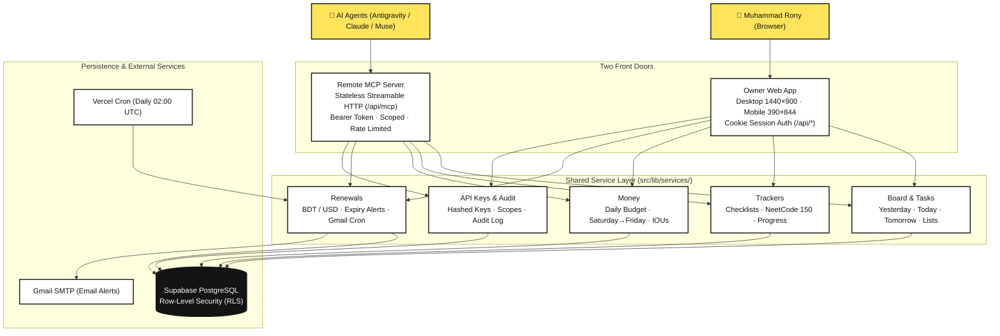

<div align="center">
  <a href="https://life.rhrony05.me">
    
  </a>
  <h1>Life Dashboard</h1>
  <p><strong>A private, single-user command center for daily tasks, trackers, small debts, and renewals — built for Muhammad Rony and his AI agents.</strong></p>
  <p>
    <a href="https://life.rhrony05.me"><strong>🌐 life.rhrony05.me</strong></a>
    &nbsp;•&nbsp;
    <a href="https://life-rony.vercel.app">Vercel Mirror</a>
  </p>

  <p>
    <a href="https://nextjs.org/"></a>
    <a href="https://www.typescriptlang.org/"></a>
    <a href="https://tailwindcss.com/"></a>
    <a href="https://modelcontextprotocol.io/"></a>
    <a href="https://supabase.com/"></a>
    <a href="https://vercel.com/"></a>
    <a href="LICENSE"></a>
  </p>
</div>

---

## System Architecture & Feature Map

<div align="center">
  
</div>

### System Flow Diagram



---

## The Problem & The Solution

### The Problem
During his final year at university and freelance work, Muhammad Rony's day lived scattered across disconnected apps:
- **Tasks lived in his head:** Deadlines were easily missed or caused constant mental fatigue.
- **Debts lived in phone notes:** Small balances borrowed or lent to friends ("who owes whom") were forgotten or awkward to calculate.
- **Renewals lived nowhere:** Domain expirations, server hosting bills, and student credit deadlines arrived unexpectedly, charging subscriptions without warning.
- **AI agents worked in silos:** AI pair-programmers (Antigravity, Claude Code, Muse) could not inspect what Rony was working on, add tasks, or check upcoming renewal deadlines without manual copy-pasting.

### The Solution
**Life Dashboard** is a private personal dashboard paired with an **agent-native MCP engine**:
- **Swiss Ink Design System:** Soft neo-brutalist aesthetic with crisp borders, warm yellow accents (`#FFE45C`), paper background (`#FBFAF6`), and full light/dark mode support.
- **Strict Parity:** 100% desktop (1440×900) and mobile (390×844) feature parity without horizontal drift or layout leakage.
- **Two Front Doors, One Service Layer:** Rony uses the browser web UI; AI agents connect to the `/api/mcp` endpoint via the Model Context Protocol. Both fronts call the exact same backend service functions in `src/lib/services/`.
- **Zero AI Latency & Complete Control:** The app does not call external LLMs internally. The agents connecting from the outside *are* the AI.

---

## What You Can Do

### 1. Yesterday · Today · Tomorrow Board
A focused daily board organized around real human working habits:
- **Calendar Days in `Asia/Dhaka`:** Natural day transitions anchored to local time.
- **Sticky Tasks:** Tasks stay on their assigned day until explicitly moved or marked done. Nothing disappears automatically.
- **Older Unfinished Tasks:** Unfinished tasks from previous days stay visible under Yesterday in an expandable badge with one-click "Move all to today".
- **Custom Lists:** Create undated target lists ("To do later", "This week's targets", "Reading list") that live alongside the board.
- **Keyboard Navigation:** Rapid task management via `N` (new task), `E` (edit), `X` (toggle done), `J`/`K` (navigate), and `?` (shortcut cheatsheet).
- **Right Rail:** Instant visibility into quick links, upcoming renewals (next 14 days), net debt balances, and tracker milestones.

### 2. Goal Trackers
Keep long-running technical lists and personal curricula organized:
- **Discrete Progress Checklists:** Built for lists with fixed goals (e.g. NeetCode 150, System Design topics, Book trackers).
- **Progress Metrics:** Visual percentage and completion ratios (e.g., `42 / 150 completed`).
- **Filter & Search:** Filter by active, completed, or remaining items with immediate client-side responsiveness.

### 3. Money & IOUs (Whole BDT)
Track daily expenses and personal debts in taka (`৳`) with zero decimal noise:
- **Monthly Budget Pacing:** Visual progress bar tracking spending against monthly limits and days remaining.
- **Weekly Cycles:** Budgeting weeks aligned from **Saturday to Friday** matching Bangladeshi working and weekend schedules.
- **Who Owes Whom (IOUs):** Log lent and borrowed amounts with names, notes, and 1-click settlement.
- **Net Balance Calculation:** Instantly see total money you are owed vs. money you owe.

### 4. Renewals & Subscriptions (BDT & USD)
Never get hit by surprise subscription renewals or expired student credits:
- **Multi-Currency:** Support for subscriptions in **BDT or USD** with separate totals (no misleading automatic conversions).
- **Billing Cycles:** Monthly, annual, or one-off renewal tracking.
- **Automated Daily Reminder Cron:** Vercel Cron triggers `/api/cron/daily` at 08:00 BST (02:00 UTC), sending warning emails via **Gmail SMTP** 7 days, 3 days, and 1 day before renewal.

### 5. Remote MCP Server & AI Agent Hub
Enable autonomous AI assistants (Antigravity, Claude Code, Muse) to collaborate directly:
- **Streamable HTTP MCP Endpoint:** Remote Model Context Protocol server running at `/api/mcp`.
- **Scoped & Revocable API Keys:** Keys are hashed with SHA-256 (only shown once at creation) with granular permissions (`tasks:read`, `tasks:write`, `trackers:*`, `money:*`, `renewals:*`).
- **Agent Guardrails:** Agents get read, create, and update capabilities, but **no delete tools**. Destructive actions remain human-only.
- **Immutable Audit Logging:** Every agent request, tool name, timestamp, and response status is recorded in an audit log visible in the Settings dashboard.
- **Rate Limiting:** Built-in protection limiting keys to 30 requests per minute and 1,000 requests per day.

---

## Local Setup & Deployment

If you want to run your own instance of Life Dashboard:

### 1. Prerequisites
- **Node.js** ≥ 20
- **npm** ≥ 10
- **Git**
- A **[Supabase](https://supabase.com/)** PostgreSQL database
- A **Gmail App Password** (for daily renewal reminder emails)

### 2. Clone and Install
```bash
git clone https://github.com/RHRONY05/Life_Dashboard.git
cd Life_Dashboard
npm install
```

### 3. Environment Variables
Create a `.env.local` file in the root directory:

```ini
# Supabase Configuration
NEXT_PUBLIC_SUPABASE_URL=https://<your-project-ref>.supabase.co
NEXT_PUBLIC_SUPABASE_ANON_KEY=<your-anon-key>
SUPABASE_SERVICE_ROLE_KEY=<your-service-role-key>

# Owner Authentication & Access Control
ALLOWED_EMAIL=muhammadrony147@gmail.com
OWNER_PASSWORD=<your-secure-password>
OWNER_USER_ID=<supabase-auth-user-id>

# App Timezone
APP_TIMEZONE=Asia/Dhaka

# Gmail SMTP (Renewal Reminders)
SMTP_USER=muhammadrony147@gmail.com
SMTP_PASSWORD=<your-16-char-gmail-app-password>
ALERT_EMAIL=muhammadrony147@gmail.com

# Cron Security
CRON_SECRET=<your-cron-secret-token>

# E2E Test Credentials (Optional)
E2E_EMAIL=e2e+life@gmail.com
E2E_PASSWORD=<e2e-user-password>
```

| Variable | Description |
|---|---|
| `NEXT_PUBLIC_SUPABASE_URL` | Your Supabase project URL. |
| `NEXT_PUBLIC_SUPABASE_ANON_KEY` | Public anonymous key for client-side queries. |
| `SUPABASE_SERVICE_ROLE_KEY` | Supabase service-role key (used by MCP backend to enforce code-level agent scopes). |
| `ALLOWED_EMAIL` | Single-user boundary: only this email can authenticate into the dashboard. |
| `OWNER_PASSWORD` | Strong password used for owner authentication. |
| `OWNER_USER_ID` | Owner UUID in `auth.users` for RLS association. |
| `APP_TIMEZONE` | Calendar timezone for day cutoffs (defaults to `Asia/Dhaka`). |
| `SMTP_USER` & `SMTP_PASSWORD` | Gmail address and 16-character App Password for reminder emails. |
| `CRON_SECRET` | Bearer token protecting `/api/cron/daily` against unauthorized triggers. |

### 4. Database Setup
1. Open your Supabase project's SQL editor.
2. Run the migrations in sequence from `supabase/migrations/`:
   - `20261102215000_life_init.sql` (Tables, columns, indexes, RLS policies)
   - `20261102215300_cover_foreign_keys.sql` (Composite indexes and performance constraints)
3. Confirm that the tables are created: `tasks`, `task_lists`, `trackers`, `tracker_items`, `expenses`, `ious`, `renewals`, `quick_links`, `api_keys`, `audit_logs`.

### 5. Run Locally
```bash
npm run dev
```
Open [http://localhost:3000](http://localhost:3000) and sign in using your `ALLOWED_EMAIL` and `OWNER_PASSWORD`.

### 6. Run Test Suites
```bash
# Unit tests
npm run test:unit

# End-to-end tests (Desktop & Mobile)
npm run test:e2e

# Typecheck and ESLint
npm run typecheck
npm run lint
```

---

## Deployment (Vercel)

1. Push your repository to GitHub.
2. Import the project into **[Vercel](https://vercel.com/)**.
3. In Project Settings → Environment Variables, add the production variables defined above.
4. Deploy! Next.js 16 App Router builds automatically with Turbopack.
5. Vercel Cron automatically reads `vercel.json` to invoke `/api/cron/daily` every day at `02:00 UTC` (`08:00 BST`).

---

## License

This project is personal and available under the [MIT License](LICENSE) © 2026 [Muhammad Rony](https://github.com/RHRONY05).
