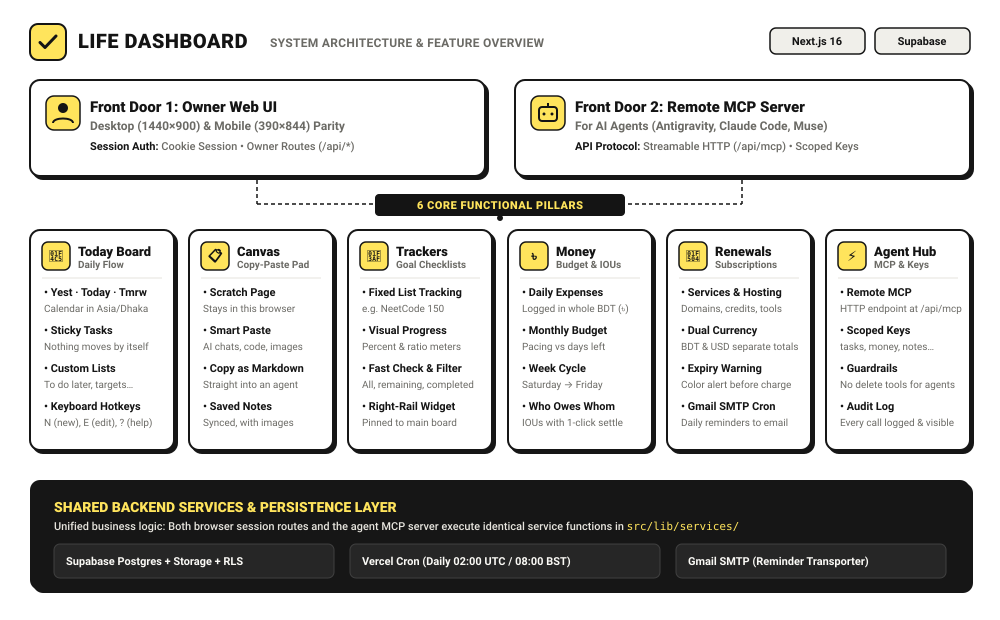

<div align="center">
  <a href="https://life.rhrony05.me">
    
  </a>
  <h1>Life Dashboard</h1>
  <p><strong>My private command center for daily tasks, trackers, small debts, and renewals — built for me and my AI agents.</strong></p>
  <p>
    <a href="https://life.rhrony05.me"><strong>🌐 life.rhrony05.me</strong></a>
    &nbsp;•&nbsp;
    <a href="https://life-rony.vercel.app">Vercel Mirror</a>
  </p>

  <p>
    <a href="https://nextjs.org/"></a>
    <a href="https://www.typescriptlang.org/"></a>
    <a href="https://tailwindcss.com/"></a>
    <a href="https://modelcontextprotocol.io/"></a>
    <a href="https://supabase.com/"></a>
    <a href="https://vercel.com/"></a>
    <a href="LICENSE"></a>
  </p>
</div>

---

## System Architecture & Feature Map

<div align="center">
  
</div>

---

## Why I Built This

I am currently in my final year of university, studying computer science, picking up freelance client projects, and coding almost daily with autonomous AI agents. 

Before building **Life Dashboard**, my daily life was basically running on pure adrenaline and chaos:
- **My daily tasks lived purely in my head:** I would tell myself *"I'll definitely remember to submit that lab report and reply to that client by 5 PM"*, only to experience a full-blown panic attack at 11:58 PM.
- **My small debts lived in messy phone notes:** Whenever my friends and I had lunch, small borrowings and lendings (*"who owes whom"*) ended up scattered across phone notes and random WhatsApp messages. Half the time, I forgot who owed me money or felt awkward calculating it.
- **My renewal dates lived nowhere at all:** Domains, cloud servers, software subscriptions, and student trial credits would expire silently — or worse, suddenly hit my credit card with surprise renewal charges because I forgot to cancel a trial.
- **My AI pair-programmers were working in the dark:** I collaborate daily with autonomous coding agents (Claude Code, Antigravity, Muse). Yet none of them had any idea what I was actually supposed to work on today. I was spending half my time acting as their unpaid human secretary, manually copy-pasting tasks between chats.

> **The realization:**  
> My brain simply doesn't have enough RAM to remember Dijkstra's algorithm, keep track of who owes me 200 taka for campus biryani, **and** remember which free trial is going to charge my card tomorrow morning.  
> 
> If AI agents are supposedly going to take over software engineering anyway, the very least they can do right now is help me do my chores and keep my day organized.

So I decided to build **Life Dashboard** as my personal daily command center.

---

## How It Works: Two Front Doors, One Service Layer

I wanted an app that is fast, beautiful, and accessible to both me and my agents without cutting corners:

1. **Front Door 1 (For Me):** A responsive web app with a custom **Swiss Ink** design system (soft neo-brutalism, warm `#FFE45C` yellow accent, crisp borders, and dark mode toggle). Built with strict parity: 100% of features work identically on my desktop monitor (1440×900) and on my phone (390×844) while on the go.
2. **Front Door 2 (For My AI Agents):** A remote, stateless Streamable HTTP **Model Context Protocol (MCP)** server running at `/api/mcp`. My agents connect using hashed, scoped API keys (`tasks:read`, `tasks:write`, `trackers:*`, `money:*`, `renewals:*`).
3. **Unified Backend Services:** Both front doors call the exact same backend service functions in `src/lib/services/`. There is no separate or outdated public API — whenever an agent updates my board or adds an expense, it runs the exact same code my browser runs.
4. **Zero AI Latency & Guardrails:** The web app itself doesn't call an LLM on every page load (keeping it instantaneous and free of API bill spikes). The agents connecting from outside *are* the AI. And for safety, agents are given **no delete tools** — only I can delete my data.

---

## What I Can Do

### 1. Yesterday · Today · Tomorrow Board
My central daily workspace:
- **Calendar Days in `Asia/Dhaka`:** Day transitions and dates are permanently anchored to my local timezone.
- **Sticky Tasks:** Tasks stay on their assigned day until I (or one of my agents) check them off or move them. Nothing vanishes automatically overnight.
- **Older Unfinished Tasks:** Any unfinished tasks from previous days remain clearly visible under Yesterday with a 1-click *"Move all to today"* button.
- **Custom Lists:** I keep undated target lists ("To do later", "This week's targets", "Reading list") right beside my daily board.
- **Keyboard Shortcuts:** Fast management with `N` (new task), `E` (edit), `X` (toggle done), `J`/`K` (navigate), and `?` (shortcuts cheat-sheet).
- **Right Rail Widget:** Immediate glance at my quick links, upcoming renewals (next 14 days), net debt balance, and tracker progress.

### 2. Goal Trackers
For structured, long-term technical learning:
- **Fixed Checklist Tracking:** Tailored for discrete goals like completing the **NeetCode 150**, system design patterns, or books.
- **Visual Progress:** Real-time percentage meters and ratio completion counts (e.g. `42 / 150 completed`).
- **Instant Filtering:** Filter between all, remaining, and completed items without full page reloads.

### 3. Money & IOUs (Whole BDT)
Tracking daily expenses and personal debts in taka (`৳`) without confusing decimal noise:
- **Monthly Budget Pacing:** A visual pacing bar showing how much I have spent versus how many days remain in the month.
- **Saturday → Friday Cycle:** Budgeting weeks aligned with Bangladesh's working and weekend rhythm.
- **Who Owes Whom (IOUs):** Quick logging of who lent or borrowed what, with 1-click settlement and net balance calculation.

### 4. Renewals & Subscriptions (BDT & USD)
No more surprise credit card charges:
- **Multi-Currency:** Keeps subscriptions in their native currency (**BDT or USD**) with separate totals — no misleading daily exchange rate conversions.
- **Expiry Warnings:** Clear visual color warnings as renewal dates approach.
- **Automated Daily Reminder Emails:** A Vercel Cron runs daily at 08:00 BST (02:00 UTC) to check renewals and sends reminder emails directly to my Gmail inbox via **Gmail SMTP** (7 days, 3 days, and 1 day before charge).

### 5. Agent Hub & Remote MCP Server
Where I pair-program with my AI agents:
- **Remote Streamable HTTP Endpoint:** Live at `/api/mcp`.
- **Hashed, Scoped API Keys:** Every agent has its own key with granular permissions. Keys are SHA-256 hashed and shown only once upon creation.
- **Immutable Audit Logging:** Every single agent tool invocation, timestamp, parameter, and response code is logged and visible in my Settings dashboard.
- **Rate Limiting:** Built-in rate limits (30 requests/min, 1,000 requests/day) prevent rogue agent loops from exhausting database resources.

---

## Local Setup & Deployment

If you want to run your own instance of Life Dashboard:

### 1. Prerequisites
- **Node.js** ≥ 20
- **npm** ≥ 10
- **Git**
- A free **[Supabase](https://supabase.com/)** PostgreSQL database
- A **Gmail App Password** (for daily renewal reminder emails)

### 2. Clone and Install
```bash
git clone https://github.com/RHRONY05/Life_Dashboard.git
cd Life_Dashboard
npm install
```

### 3. Environment Variables
Create a `.env.local` file in the root directory:

```ini
# Supabase Configuration
NEXT_PUBLIC_SUPABASE_URL=https://<your-project-ref>.supabase.co
NEXT_PUBLIC_SUPABASE_ANON_KEY=<your-anon-key>
SUPABASE_SERVICE_ROLE_KEY=<your-service-role-key>

# Owner Authentication & Access Control
ALLOWED_EMAIL=muhammadrony147@gmail.com
OWNER_PASSWORD=<your-secure-password>
OWNER_USER_ID=<supabase-auth-user-id>

# App Timezone
APP_TIMEZONE=Asia/Dhaka

# Gmail SMTP (Renewal Reminders)
SMTP_USER=muhammadrony147@gmail.com
SMTP_PASSWORD=<your-16-char-gmail-app-password>
ALERT_EMAIL=muhammadrony147@gmail.com

# Cron Security
CRON_SECRET=<your-cron-secret-token>

# E2E Test Credentials (Optional)
E2E_EMAIL=e2e+life@gmail.com
E2E_PASSWORD=<e2e-user-password>
```

| Variable | Description |
|---|---|
| `NEXT_PUBLIC_SUPABASE_URL` | Your Supabase project URL. |
| `NEXT_PUBLIC_SUPABASE_ANON_KEY` | Public anonymous key for client-side queries. |
| `SUPABASE_SERVICE_ROLE_KEY` | Supabase service-role key (used by MCP backend to enforce code-level agent scopes). |
| `ALLOWED_EMAIL` | Single-user boundary: only this email can authenticate into the dashboard. |
| `OWNER_PASSWORD` | Strong password used for owner authentication. |
| `OWNER_USER_ID` | Owner UUID in `auth.users` for RLS association. |
| `APP_TIMEZONE` | Calendar timezone for day cutoffs (defaults to `Asia/Dhaka`). |
| `SMTP_USER` & `SMTP_PASSWORD` | Gmail address and 16-character App Password for reminder emails. |
| `CRON_SECRET` | Bearer token protecting `/api/cron/daily` against unauthorized triggers. |

### 4. Database Setup
1. Open your Supabase project's SQL editor.
2. Run the migrations in sequence from `supabase/migrations/`:
   - `20261102215000_life_init.sql` (Tables, columns, indexes, RLS policies)
   - `20261102215300_cover_foreign_keys.sql` (Composite indexes and performance constraints)
3. Confirm the tables are created: `tasks`, `task_lists`, `trackers`, `tracker_items`, `expenses`, `ious`, `renewals`, `quick_links`, `api_keys`, `audit_logs`.

### 5. Run Locally
```bash
npm run dev
```
Open [http://localhost:3000](http://localhost:3000) and sign in using your `ALLOWED_EMAIL` and `OWNER_PASSWORD`.

### 6. Run Test Suites
```bash
# Unit tests
npm run test:unit

# End-to-end tests (Desktop & Mobile)
npm run test:e2e

# Typecheck and ESLint
npm run typecheck
npm run lint
```

---

## Deployment (Vercel)

1. Push your repository to GitHub.
2. Import the project into **[Vercel](https://vercel.com/)**.
3. In Project Settings → Environment Variables, add the production variables defined above.
4. Deploy! Next.js 16 App Router builds automatically with Turbopack.
5. Vercel Cron automatically reads `vercel.json` to invoke `/api/cron/daily` every day at `02:00 UTC` (`08:00 BST`).

---

## License

This project is personal and available under the [MIT License](LICENSE) © 2026 [Muhammad Rony](https://github.com/RHRONY05).
